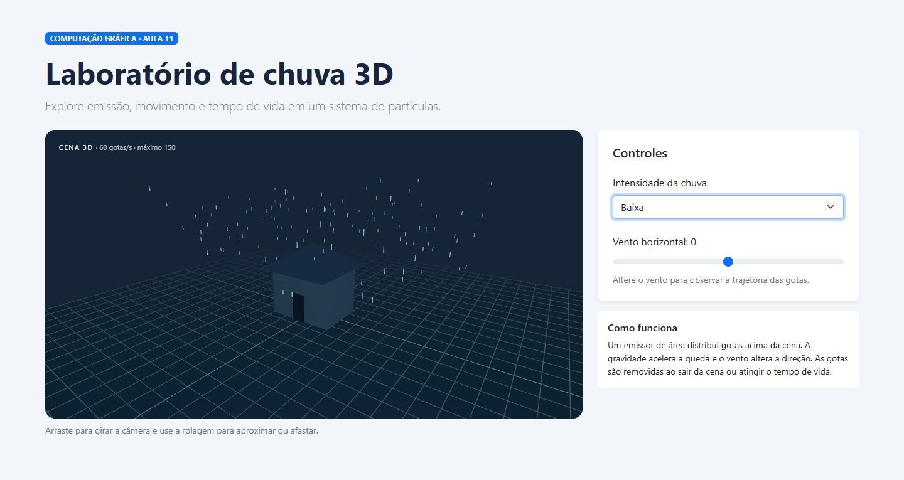
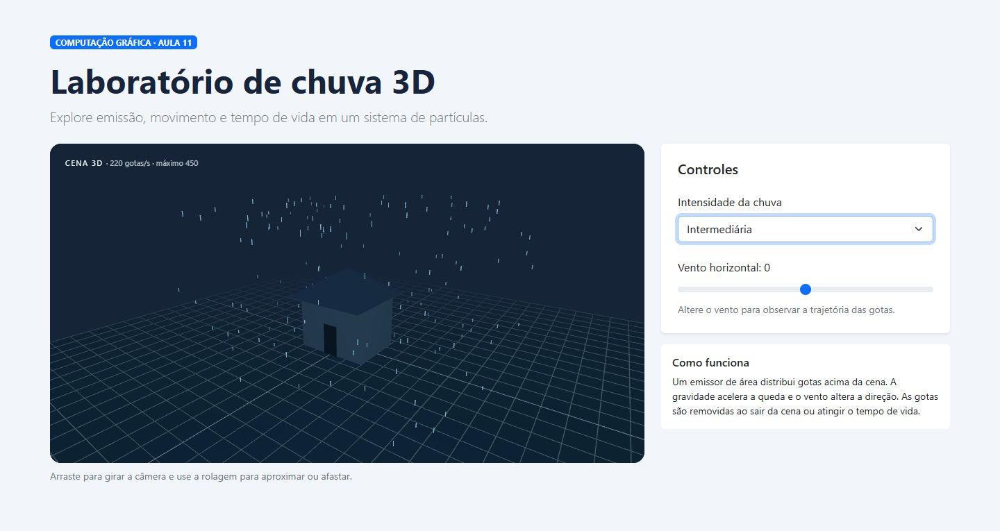
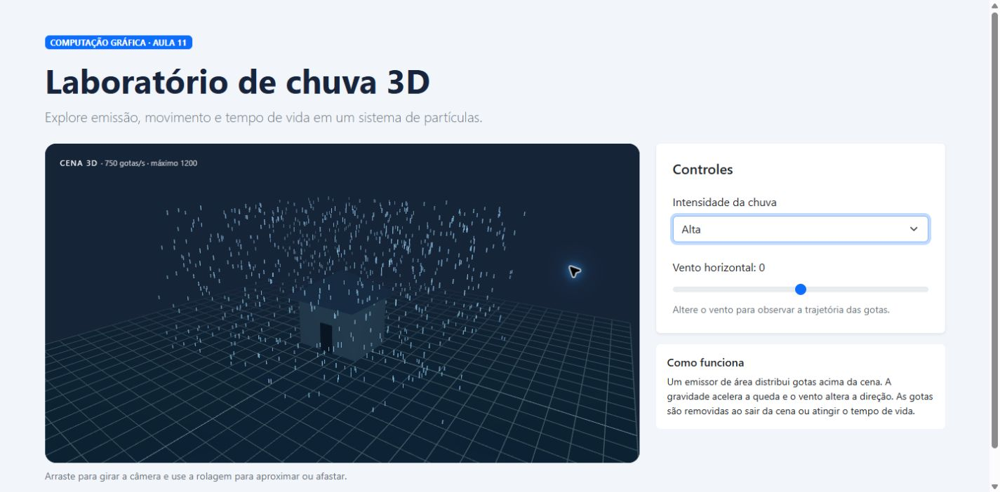

# Sistema de partículas: chuva

Protótipo para a Aula de Computação Gráfica e Realidade Virtual. Feito com React, Bootstrap e Three.js. A cena representa chuva e permite ajustar intensidade e vento. A cena é tridimensional, com câmera controlável e objetos 3D.

## Executar

https://sistema-particulas-chuva.vercel.app/

## Organização

- `src/components`: interface, controles e canvas.
- `src/particles/engine.js`: criação, atualização, remoção e desenho das partículas.
- `src/App.jsx`: composição e estado da aplicação.

## Preparação: decisões técnicas

As decisões abaixo são sugestões plausíveis para uma aula introdutória sobre partículas. Elas não foram confirmadas como observações do vídeo e devem ser conferidas ao assisti-lo.

| Decisão técnica sugerida | Por que é necessária |
|---|---|
| Configurar o emissor e a taxa de emissão. | Define onde as partículas surgem e quantas são criadas ao longo do tempo, permitindo controlar a densidade do efeito. |
| Definir o tempo de vida e limitar a quantidade de partículas. | Evita que partículas permaneçam indefinidamente na cena e que o consumo de processamento e memória cresça sem controle. |
| Ajustar velocidade, direção e aparência das partículas. | Faz o movimento e o aspecto visual corresponderem ao fenômeno escolhido, como gotas que caem e são deslocadas pelo vento. |

## Compreensão

1. Um sistema de partículas controla um conjunto de pequenas entidades que nascem, mudam e desaparecem ao longo do tempo.
2. Muitas entidades simples permitem representar fenômenos irregulares e dinâmicos, como chuva, sem modelar cada gota individualmente.
3. A partícula representa uma gota com posição, velocidade e idade; o sistema gerencia emissão, atualização, desenho e remoção do conjunto.
4. O emissor define onde, quando e quantas partículas nascem.
5. A atualização por quadro permite que posição e aparência evoluam ao longo do tempo. O cálculo usa o tempo decorrido para reduzir a dependência da taxa de quadros.
6. Sem limite de criação, a quantidade cresce continuamente, consumindo memória e processamento.
7. Limitar a quantidade máxima e remover partículas expiradas são duas estratégias de controle de custo.
8. Emissão → movimento → atualização da aparência → desenho → remoção. Primeiro as gotas nascem, depois são atualizadas e exibidas; por fim, as expiradas são removidas. Na implementação a remoção ocorre antes do desenho para evitar mostrar partículas já expiradas; a lógica visual é equivalente.

## Planejamento

| Item | Decisão |
|---|---|
| Fenômeno | Chuva |
| Emissor | Área horizontal acima da cena 3D |
| Quantidade máxima | 150, 450 ou 1200, conforme intensidade |
| Taxa de emissão | 60, 220 ou 750 gotas por segundo |
| Tempo de vida | Aleatório entre 1,8 e 2,3 segundos; a gota também pode sair da cena antes |
| Velocidade inicial | Entre 4 e 6 unidades de mundo por segundo |
| Força | Aceleração vertical de 3 unidades/s²; vento horizontal controlável |
| Tamanho | Traço de 0,22 unidade de mundo |
| Cor e transparência | Azul claro translúcido |
| Remoção | Ao expirar ou sair dos limites da cena |
| Controle | Intensidade e vento |
| Função no A3 | Proposta: criar atmosfera de chuva em uma área externa |

O emissor distribuído em uma área acima da cena, a aceleração para baixo e os traços finos sugerem gotas caindo. A variação de velocidade e tamanho reduz a aparência uniforme; a transparência permite sobreposição. O vento altera a trajetória e torna o fenômeno interativo.

## Experimento controlado

As capturas abaixo mostram as três intensidades com o vento em zero. As configurações são:

| Configuração | Máximo | Emissão | Vida | Expectativa visual |
|---|---:|---:|---|---|
| Baixa | 150 | 60/s | 1,8–2,3 s | Gotas espaçadas |
| Intermediária | 450 | 220/s | 1,8–2,3 s | Chuva perceptível sem cobrir toda a cena |
| Alta | 1200 | 750/s | 1,8–2,3 s | Chuva densa, com maior custo |

### Baixa

### Intermediária

### Alta

| Pergunta | Resposta |
|---|---|
| Em qual configuração o efeito ficou mais legível? | Na intermediária. A chuva fica perceptível e a casa continua visível. |
| Em qual configuração o desempenho começou a cair? | Não foi medido, então não é possível afirmar. A intensidade alta tende a exigir mais processamento por ter mais partículas; isso é uma estimativa técnica. |
| Aumentar a quantidade sempre melhorou o resultado? | Não. Na intensidade alta, a sobreposição das gotas pode dificultar a visualização da cena. |
| Qual configuração você escolheria para a demonstração? Por quê? | A intermediária, pois equilibra a visibilidade da chuva com a leitura dos objetos da cena. |

## Integração proposta com A3

| Pergunta | Resposta |
|---|---|
| Onde o efeito aparece na cena? | Na área externa da cena 3D, caindo sobre o terreno e ao redor da casa. |
| O que o usuário deve perceber? | A chuva caindo e mudando de intensidade e direção conforme os controles são ajustados. |
| O efeito responde a uma interação? | Sim. O usuário pode escolher a intensidade da chuva e ajustar o vento. |
| Qual evento inicia ou altera o sistema? | A chuva começa quando a aplicação é aberta. Ela é alterada quando o usuário muda a intensidade ou o vento nos controles. |
| Como se relaciona com RV, RA, RM ou simulação? | Relaciona-se com simulação, pois representa o comportamento da chuva em um ambiente tridimensional. O efeito pode ser adaptado futuramente para uma experiência de realidade virtual. |

Essas respostas descrevem o protótipo atual; a integração com o projeto A3 ainda será definida pelo grupo.

## Fechamento

As gotas em movimento, com velocidades e trajetórias diferentes, comunicam a evolução da chuva e permitem interação. Uma imagem estática não mostra essa mudança ao longo do tempo da mesma forma.

## Referências e ferramentas

- CFB Cursos. [Unity 3D — Aula 37 — Introdução a Sistemas de Partículas](https://www.youtube.com/watch?v=1qBcNkvYNbs). Vídeo principal indicado no exercício.
- e-Aulas USP. [Mecânica — Tema 15 — Sistemas de Partículas](https://eaulas.usp.br/portal/video.action?idPlaylist=6999). Material complementar indicado no exercício.
- [Three.js](https://threejs.org/), [React](https://react.dev/), [Bootstrap](https://getbootstrap.com/), [Vite](https://vite.dev/) e WebGL: bibliotecas e tecnologias usadas no protótipo.

